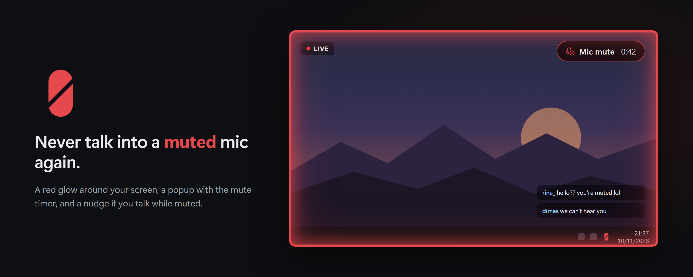

<p align="center"></p>

<h1 align="center">Sirah Mute</h1>

<p align="center">
  <a href="https://kurohiko.id">kurohiko.id</a> ·
  <a href="https://saweria.co/Kurohiko">Donate via Saweria</a> ·
  <a href="https://kurohikotopup.com">Game top-ups at KurohikoTopUp</a>
</p>

<p align="center"><a href="README.md">English</a> · <b>Bahasa Indonesia</b></p>

---

**Jangan sampai ngomong ke mic yang lagi mute lagi.**

Gw Kurohiko. Gw udah batuk bertahun-tahun, jadi pas stream gw sering banget pencet mute. Masalahnya di sisi lain: gw sering lupa unmute, terus ngomong sendirian bermenit-menit. Sirah Mute ini solusinya. Mute tetap satu tombol, tapi sekarang kelihatan jelas: layar dikelilingi cahaya merah, ada popup yang ngitung udah berapa lama mute, dan ada peringatan kalau lu ngomong pas lagi mute.

*Sirah* artinya merah dalam bahasa Minang.

## Fitur

- **Mute satu tombol** untuk mic pilihan lu, dari app atau game apa pun. Bisa tombol atau kombinasi apa aja, termasuk F13–F24 dan tombol media.
- **Border layar merah** selama mute. Gaya Solid atau Glow, tebal bisa diatur, dan berkedip sebentar waktu baru mute.
- **Popup dengan timer mute**: `Mic mute 0:42`. Gaya Pill atau Kartu, di sudut mana aja, ukuran bebas, dan bisa tetap tampil selama mute.
- **Peringatan ngomong pas mute**: baca level mic fisik lu, lalu border berkedip (opsional bunyi beep) kalau lu ngomong pas lagi mute. Jalan juga di setup kayak Wave Link yang di-mute mic virtualnya.
- **Jaga device default**: pilih input dan output, lalu Sirah Mute bisa maksa pas startup, kasih notifikasi, atau balikin otomatis kalau Windows diam-diam menggantinya.
- **Ikon tray nunjukin status**: kapsul abu-abu = mic hidup, kapsul merah = mute, badge kuning = mic nggak ketemu.
- Pilih monitor mana yang nampilin border dan popup, bunyi beep mute/unmute (opsional), jalan saat Windows start, cek update, bahasa Inggris dan Indonesia.
- **Ringan**: satu exe, RAM sekitar 3,5 MB, dari tombol sampai indikator cuma beberapa milidetik. Koneksi internet cuma buat cek update ke GitHub dan statistik anonim (lihat [Privasi](#privasi)).

## Install

Unduh **SirahMute-Setup.exe** (installer per-user, tanpa admin) atau zip portable dari [Releases](../../releases/latest).

> **Windows SmartScreen:** rilis belum di-code-sign, jadi Windows bisa nampilin "Windows protected your PC". Klik **More info → Run anyway**.

### Pindahan dari Kuro Mute & Force Mic?

Sirah Mute adalah versi baru Kuro Mute. Settingan lama otomatis kebawa waktu pertama jalan, dan entri autostart app lama diganti. Setelah itu Kuro Mute boleh di-uninstall.

## Privasi

Halo, aku Kurohiko, developer Sirah Mute. Aku sangat menghargai privasi kalian.

Supaya Sirah Mute bisa terus berkembang ke arah yang tepat, aku butuh beberapa data dasar: berapa orang yang menginstal, fitur apa saja yang dipakai, kira-kira seberapa sering mute, dan versi Windows apa yang kalian gunakan. Dari situ aku bisa melihat fitur mana yang layak ditingkatkan, dan fitur mana yang ternyata jarang dipakai.

Semua data ini **sepenuhnya anonim**. Aku tidak tahu siapa yang menginstal Sirah Mute, dan tidak tahu siapa yang memakai fitur apa.

**Yang dikirim:**

- ID acak yang dibuat saat Sirah Mute pertama kali dibuka. ID ini tidak terhubung ke akun, nama, atau perangkat kalian.
- Versi Sirah Mute, versi Windows, dan bahasa sistem.
- Negara, diperkirakan dari koneksi. Alamat IP tidak disimpan.
- Nama pengaturan yang sedang aktif, misalnya border Glow/Solid, popup Pill/Card beserta posisinya dan apakah tetap tampil selama mute, peringatan bicara saat mute, beep, penjaga perangkat default, jalan saat Windows start, dan apakah hotkey diganti. Tiap pengaturan dihitung paling banyak sekali sehari, jadi tidak ada catatan per klik.
- Seberapa sering kalian mute tiap hari, hanya dalam rentang kasar: berapa kali (1–5, 6–20, 21–50, lebih dari 50) dan total lamanya (di bawah 5 menit, 5–30 menit, 30 menit–2 jam, lebih lama). Waktu dan lama tiap mute tidak dikirim.
- Pesan crash kalau Sirah Mute mengalami masalah. Nama folder pengguna di dalamnya disamarkan.

**Yang tidak pernah dikirim:** nama dan ID mic atau perangkat kalian, tombol hotkey yang dipakai, nama monitor, isi pengaturan, audio, dan tangkapan layar.

Data dikirim ke server milikku sendiri (`dash.kurohiko.id`), tidak dijual, dan tidak dibagikan ke pihak lain. Kode pengirimnya terbuka di [`kuromute/src/stats.rs`](kuromute/src/stats.rs). Kalau tetap tidak ingin mengirim apa pun, blokir `dash.kurohiko.id` di firewall atau file hosts. Sirah Mute tetap berjalan normal.

## Build dari source

Butuh Rust (stable, toolchain MSVC) di Windows 10/11.

```
cd kuromute
cargo build --release
```

Exe-nya ada di `target/release/sirahmute.exe`. Jalankan sekali, app-nya nongkrong di tray; klik kanan ikon tray untuk buka pengaturan.

## Dukungan

Bug dan ide: [buka issue](../../issues). Kalau Sirah Mute nyelamatin lu dari ngomel pas mute, lu bisa [traktir kopi lewat Saweria](https://saweria.co/Kurohiko) atau top up game di [KurohikoTopUp](https://kurohikotopup.com).

Jendela pengaturan dibuat pakai [Slint](https://slint.dev) dengan Slint Royalty-free License.
