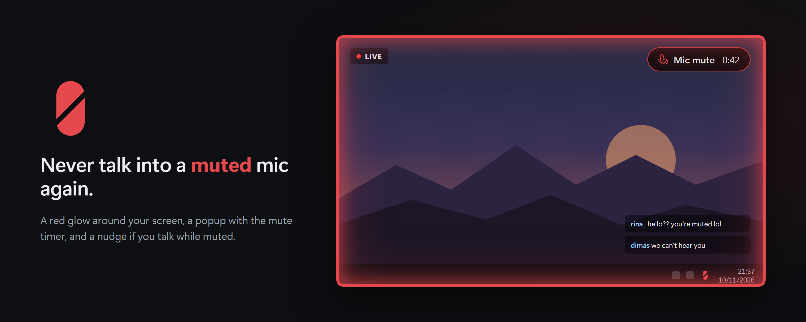

<p align="center"></p>

<h1 align="center">Sirah Mute</h1>

<p align="center">
  <a href="https://kurohiko.id">kurohiko.id</a> ·
  <a href="https://saweria.co/Kurohiko">Donate via Saweria</a> ·
  <a href="https://kurohikotopup.com">Game top-ups at KurohikoTopUp</a>
</p>

<p align="center"><b>English</b> · <a href="README.id.md">Bahasa Indonesia</a></p>

---

**Never talk into a muted mic again.**

I'm Kurohiko. I've had a cough for years, so on stream I hit mute a lot. The problem was the other half: I kept forgetting to unmute, and talked to nobody for minutes. Sirah Mute is the fix. Muting is still one key, but now it's loud about it: a red glow around your screen, a popup that counts how long you've been muted, and a nudge if you start talking while muted.

*Sirah* means red in Minang.

## Features

- **One-key mute** for the mic you pick, from any app or game. Any key or combo works, including F13–F24 and media keys.
- **Red screen border** while muted. Solid or Glow, adjustable thickness, with a short pulse when you mute.
- **Popup with a mute timer**: `Mic mute 0:42`. Pill or Card style, any corner, any size, and it can stay up the whole time you're muted.
- **Talk-while-muted warning**: reads your physical mic's level and pulses the border (optionally beeps) when you speak while muted. Works with setups like Wave Link where you mute a virtual mic.
- **Keeps your default devices**: pick your input and output, and Sirah Mute can force them at startup, notify you, or switch back automatically when Windows changes them behind your back.
- **Tray icon shows the state**: grey capsule = live, red capsule = muted, yellow badge = mic missing.
- Choose which monitors show the border and popup, optional mute/unmute beep, start with Windows, update check, English and Bahasa Indonesia.
- **Small**: one exe, about 3.5 MB of RAM, hotkey-to-indicator in a few milliseconds. No telemetry; the only network call is the GitHub update check.

## Install

Download **SirahMute-Setup.exe** (per-user installer, no admin) or the portable zip from [Releases](../../releases/latest).

> **Windows SmartScreen:** releases aren't code-signed yet, so Windows may say "Windows protected your PC". Click **More info → Run anyway**.

### Coming from Kuro Mute & Force Mic?

Sirah Mute is the new version of Kuro Mute. It picks up your old settings automatically on first start and replaces the old app's autostart entry. You can uninstall Kuro Mute afterwards.

## Build from source

Needs Rust (stable, MSVC toolchain) on Windows 10/11.

```
cd kuromute
cargo build --release
```

The exe lands in `target/release/sirahmute.exe`. Run it once and it lives in the tray; right-click the tray icon for settings.

## Support

Bugs and ideas: [open an issue](../../issues). If Sirah Mute saved you from a muted rant, you can [buy me a coffee on Saweria](https://saweria.co/Kurohiko) or top up your games at [KurohikoTopUp](https://kurohikotopup.com).

The settings window is built with [Slint](https://slint.dev) under the Slint Royalty-free License.
